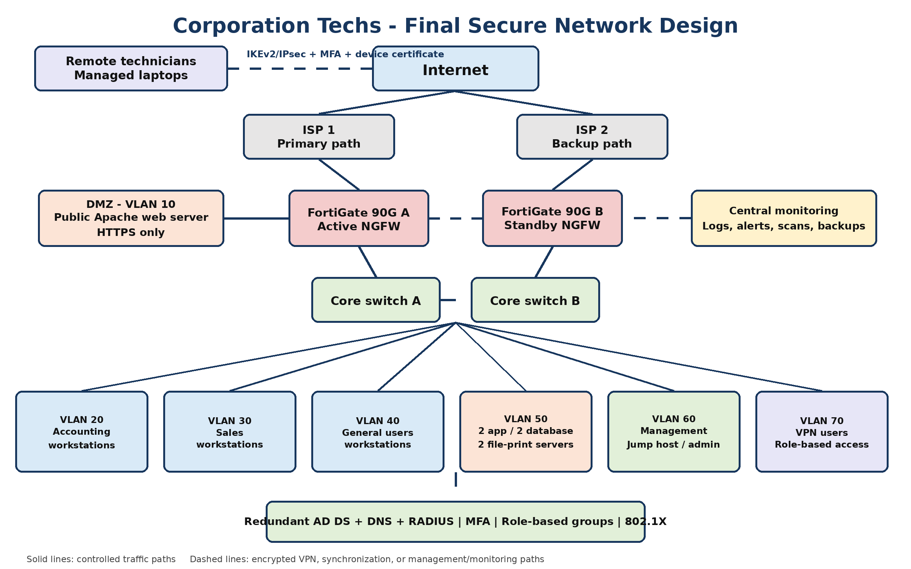

# Secure enterprise network design

**Franco Pisano · ITN 263 · Summer 2026 · Architecture capstone**

A four-stage proposal to help the fictional Corporation Techs support 24/7 operations, double its client-facing workforce and move technicians toward remote work.

## The problem

The starting scenario has a public Linux/Apache server, six internal Windows servers, roughly 50 workstations, interconnected switches and one aging border firewall. The design must improve separation, remote access and availability while allowing growth.

## Proposed design

- Dual Internet paths, a FortiGate 90G active/passive pair and redundant core switching.
- A public-web DMZ and separate Accounting, Sales, general-user, server, management and VPN zones.
- Deny-by-default inter-zone policy, with approved business dependencies documented explicitly.
- Central identity, role-based groups, MFA, certificates and 802.1X/RADIUS.
- Managed remote access through IKEv2/IPsec, full tunneling and scoped authorization.
- Central monitoring, protected backups, staged deployment, rollback and acceptance checks.

These are design choices in a course proposal. No production deployment, achieved uptime, measured throughput or completed failover test is claimed.

## Read the original progression

1. [Network requirements and topology](report/01-network-design.md)
2. [Firewall selection, placement and authentication](report/02-firewall-selection.md)
3. [Remote access and VPN design](report/03-remote-access.md)
4. [Final architecture, rollout and acceptance criteria](report/04-final-report.md)

The diagram is a high-level illustration. The final report calls for redundant connections and policy-controlled inter-zone routing; a deployment would require detailed physical links, addressing, routing and rule validation beyond this picture.

## Learning objectives and deliverables

| Objective | Delivered artifact | Status |
|---|---|---|
| Translate business needs into network requirements | Parts 1 and 4 | Design documented |
| Apply segmentation and firewall placement | Parts 2 and 4; topology | Design documented |
| Compare secure remote-access choices | Part 3 | Design documented |
| Plan identity, authorization and endpoint conditions | Parts 2–4 | Design documented |
| Define measurable rollout and acceptance criteria | Part 4 | Proposed tests; not executed results |

## Reflection

The strongest part of the project is connecting controls to business needs: remote work changes identity and endpoint requirements, public services change placement, and continuous support changes redundancy and recovery planning. A next iteration would add a dependency inventory, explicit rule matrix, capacity assumptions, failure-domain diagrams and a test environment.

## Provenance

Prepared from my four saved course submissions. Corporation Techs is the supplied scenario, not a real client engagement. Paragraphs and tables were converted to Markdown with AI assistance; the final diagram is preserved from the submitted report. Sources cited within the reports retain their original context. The separate [lab collection](https://github.com/SubnetSomm/Subnetsomm-lab) contains hands-on pfSense exercises.
